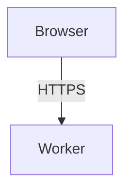

This is a standalone, local-only Starlight site. It is not deployed or included
in the application build. Reading and checking the docs requires no Wrangler,
database, Cloudflare credentials, or application secrets, and does not require
starting the application server.

## Read locally

Run these commands **from the repository root**, not from `docs/`:

```sh
pnpm install
pnpm docs:dev
```

Open [http://127.0.0.1:4322](http://127.0.0.1:4322). The documentation server runs in
the background, binds only to loopback, and fails if port 4322 is already in use
instead of choosing another port.

Manage the documentation server from the repository root:

| Command            | Purpose                                   |
| ------------------ | ----------------------------------------- |
| `pnpm docs:status` | Check whether the docs server is running. |
| `pnpm docs:logs`   | Read the docs server logs.                |
| `pnpm docs:stop`   | Stop only the docs server.                |
| `pnpm docs:check`  | Validate the docs project and content.    |

## Navigation and search

Navigate using the sidebar, the [project overview](/), and each page's table of
contents. The sidebar's **Historical benchmarks** group is collapsed by default.

Pagefind requires a production build, so search is disabled for this dev-server
reader; there is no custom search service.

## Edit the documentation

The canonical documentation source is `docs/src/content/docs/`. Edit the Markdown
files there directly rather than creating duplicate guides elsewhere in `docs/`.
The local reader updates as you save changes.

Use standard Markdown with `title` and `description` frontmatter:

```md
---
title: Guide title
description: A brief explanation of what this guide covers.
---

Introduce the guide here.

## First section

Write the section here.
```

Starlight renders the title as the page's H1, so do not repeat it as a `#` heading
in the body. Use lowercase, hyphen-separated filenames and keep routes
filename-based without custom `slug` frontmatter: `accounts.md` becomes
`/accounts/`, and `index.md` is the project overview at `/`. Link to reader routes
such as `[Accounts](/accounts/)`, not `.md` source paths. Add new guides to the
explicit sidebar in `docs/astro.config.mjs`, then run `pnpm docs:check`.

After changing the site configuration, restart the reader with `pnpm docs:stop`
followed by `pnpm docs:dev`.

## Diagrams

Write diagrams as fenced `mermaid` blocks in Markdown. They render locally in
the browser, without a diagram service or CDN, and follow the reader's theme.
Give each diagram an accessible title and description, use short labels, and
split different levels of detail into separate diagrams.

````md

````

Keep authoring instructions on this page, the high-level system map on
[Overview](/), and detailed system diagrams on their architecture pages.
