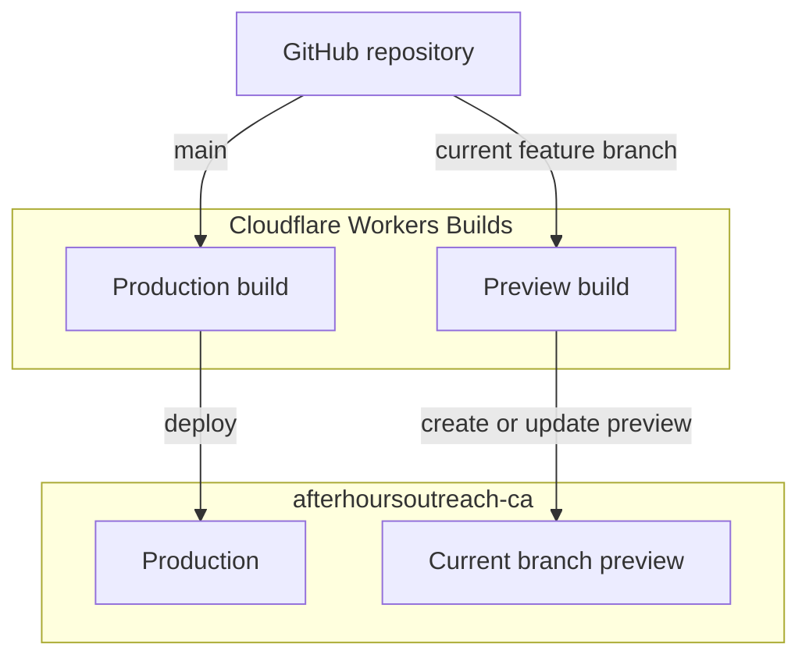
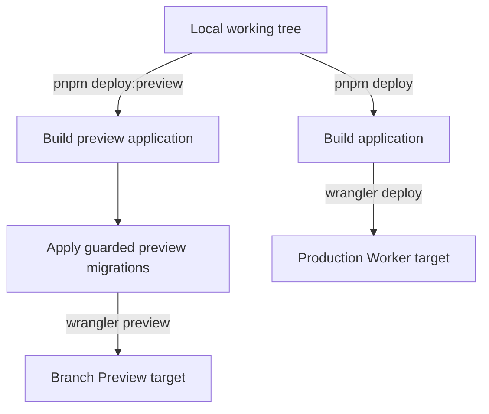
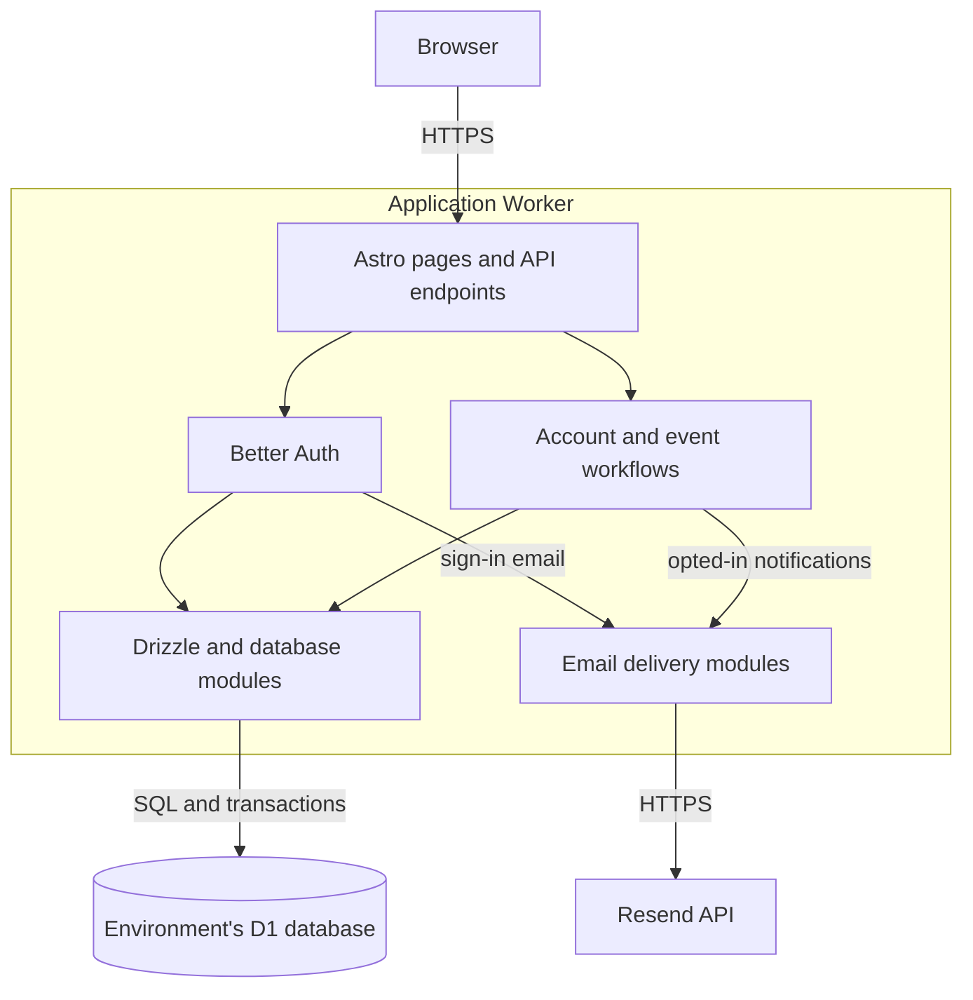
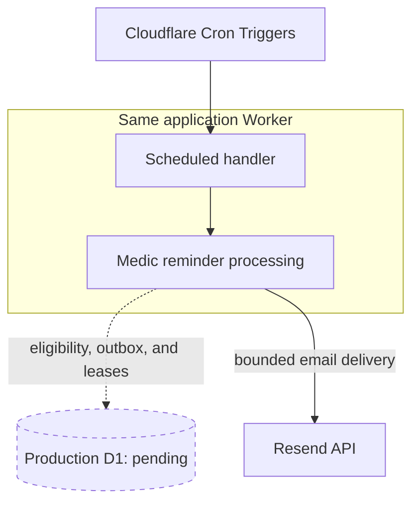

The [overview](/#system-overview) shows the external building blocks. This page
zooms in without mixing deployment steps, runtime requests, and background jobs
into one diagram. These are logical views of the application, not separate
services to provision.

## Delivery and environments

The GitHub repository is
[After-Hours-Outreach-Initiative/afterhoursoutreach.ca](https://github.com/After-Hours-Outreach-Initiative/afterhoursoutreach.ca).
`main` is the production branch. Cloudflare's Git integration and manual Wrangler
commands are two ways to deploy the application.

### Git-triggered builds



The connection lives in **Cloudflare Workers Builds**, not a checked-in GitHub
Actions workflow. GitHub reports the build through the **Cloudflare Workers and
Pages** app, with a check named **Workers Builds: afterhoursoutreach-ca**.

For the current branch, `feat/patrol-scheduling-mockup`, Wrangler uses the branch
name as the Preview name unless `--name` overrides it. Cloudflare gives it the
URL-safe slug `feat-patrol-scheduling-mockup`, producing:

```text
https://feat-patrol-scheduling-mockup-afterhoursoutreach-ca.ivanzheng9905.workers.dev
```

This is a Preview **under the existing Worker**, not another independently named
Worker and not a production version URL. Updating it does not deploy production.

The connection was checked read-only on **October 19, 2026**:

- The latest pushed branch commit, `d2a9e44`, had a successful Cloudflare build
  check linking directly to this preview's build page.
- The preview's latest deployment carried the same `d2a9e44` tag and repository
  URL. The `main` branch also had a successful production build check.
- Local, unpushed changes are not included in a Git-triggered build. A manual
  deployment can instead use the local working tree.

The complete branch allowlist and exact CI commands have **not** been verified:
the current Wrangler login could read Worker/Preview metadata but the Builds
settings API returned HTTP 403. To inspect those settings, open the Worker in
Cloudflare and check **Settings → Build → Branch control**, the build command,
and the production/preview commands. Do not assume every feature branch deploys,
or that the CI commands match the local package scripts.

### Manual deployments



Both builds use the same application source. Preview mode adds a banner and uses
its own output directory; it does not enable a different set of account features.
Deployments use the generated `dist/server/wrangler.json` or
`dist-preview/server/wrangler.json`, not `src/worker.ts` directly.

The preview script migrates the configured shared preview D1 before deployment.
Production database provisioning and migration are **separate prerequisites**,
not an automatic step in `pnpm deploy`. Neither path automatically seeds data or
bootstraps an organizer. See [Deployment](/deployment/) for the safeguards.

### Environment boundaries

| Environment       | Runtime                                                                    | Database                                                                        | Email and scheduled work                                                                            |
| ----------------- | -------------------------------------------------------------------------- | ------------------------------------------------------------------------------- | --------------------------------------------------------------------------------------------------- |
| Local development | Astro dev server with local Workers simulation                             | Persistent local D1 under `.wrangler/state/`; remote bindings disabled          | Simulated email dialogs; medic reminder jobs skipped                                                |
| Branch previews   | Previews under `afterhoursoutreach-ca`, each with its own URL and settings | Shared `afterhoursoutreach-staging` D1 by default                               | Real, rate-limited Resend delivery for sign-in and opted-in event mail; medic reminder jobs skipped |
| Production        | `afterhoursoutreach-ca` serving `afterhoursoutreach.ca`                    | Dedicated production D1 **not yet provisioned**; checked-in ID is a placeholder | Real delivery and production-only reminder processing require completed production configuration    |

Preview bindings do not grant automatic database isolation. Two branches using
the same preview D1 see and change the same preview records. Production must never
be pointed at that database. Preview secrets are configured separately from
production secrets.

The old `afterhoursoutreach-ca-staging` Worker was retired; the word `staging` in
the retained D1 name does not mean there is still a separate staging Worker.
Cloudflare manages DNS for the production domain; Porkbun is its registrar.

## Inside the Worker

This view shows a database-backed page or API request. Worker internals are
libraries and modules in the same application, not extra deployed services.



- **Astro** renders application pages on the server and routes HTTP API requests
  under `/api/v1/`. Static files are delivered through Workers Static Assets.
- **Better Auth** manages sign-in, sessions, and optional two-factor
  authentication. It uses D1 through the Drizzle adapter; it is not an external
  identity-provider service.
- **Domain workflows** apply authorization and coordinate profile, application,
  event, signup, and organizer changes. `src/server/db/` is the source of truth
  for persisted workflows; SQL constraints and triggers also protect invariants
  such as event capacity.
- **D1** holds application records, sessions, rate limits, notification outboxes,
  and delivery leases. The browser never connects to D1 directly.
- **Resend** delivers sign-in and opted-in notifications in deployed environments.
  Notifications are recorded with the originating change before delivery is
  attempted, so an email failure does not undo the saved change. Local development
  uses simulated delivery instead of contacting Resend.

See [Backend](/backend/), [Accounts](/accounts/), and [Events](/events/) for the
detailed behavior and access rules.

## Scheduled work

Medic certification reminders use the Worker's `scheduled` handler, separately
from the browser request path. The implementation is production-only and still
requires the pending production D1 and other launch prerequisites.



Daily discovery runs at **16:00 UTC**; delivery and retries run at **30 minutes
past each hour**. D1 tracks eligibility, outbox state, and atomic delivery leases;
stable Resend idempotency keys protect retries from duplicate sends.

This is not a general event-email dispatcher. Event notification delivery/retries
remain request- or organizer-triggered. Local development and `APP_ENV !=
production`, including branch previews, skip medic reminder processing. The
configured Cron Triggers target production, not a per-preview scheduler. See
[Deployment: medic certification reminders](/deployment/#medic-certification-reminders).
